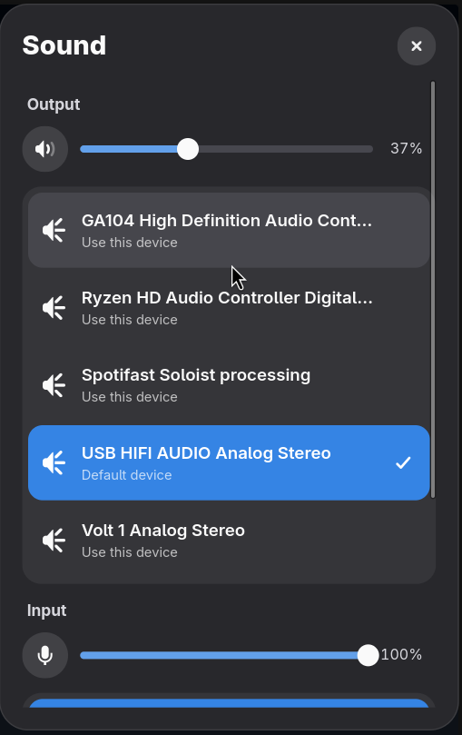

# wpwidget - WirePlumber Widget

I used to use the wireplumber module of waybar but then switching between audio sinks is a hassle because of the wpctl cli and changing ids e.g. `wpctl set-default 54`.
So i asked the nice little daemon in my computer to build a small gtk widget to help me

<p align="center">
  
</p>

## Runtime Requirements

- Linux with GTK4 and GTK4 layer-shell (1.0 or newer) runtime libraries.
- PipeWire (`pw-dump`) and WirePlumber (`wpctl`), running in your user session.
- A desktop session with D-Bus for the single-instance menu toggle.
- Waybar for bar integration. A Wayland compositor supporting layer-shell, such
  as Sway, Hyprland, or Niri, enables corner positioning; other desktops use a
  normal window.
- A symbolic icon theme such as Adwaita for the popup. The example Waybar config
  also uses Nerd Font icons; install a matching font or customize `format-icons`.

On Arch Linux, install `gtk4 gtk4-layer-shell pipewire wireplumber waybar
adwaita-icon-theme`. Prebuilt binaries do not require Rust or development tools;
see [GitHub releases](#github-releases) for artifact compatibility.

# And now the AI Giberish:

A GNOME-style GTK4 audio menu for Waybar, with separate output and input device
lists, volume sliders, and mute buttons. Selected devices are highlighted;
switching shows a spinner. Device lists and levels refresh automatically.

## GitHub releases

Open the repository's **Releases** page, choose the latest stable version, and
expand **Assets**. Download `wpwidget-linux-x86_64.tar.gz` and its `.sha256` file.
From the download directory, verify, extract, and install:

```sh
sha256sum --check wpwidget-linux-x86_64.tar.gz.sha256
tar -xzf wpwidget-linux-x86_64.tar.gz
install -Dm755 wpwidget ~/.local/bin/wpwidget
```

The archive contains the Linux x86_64 executable, Waybar configuration examples,
and this README. Install the runtime dependencies above; the prebuilt binary
also requires glibc 2.39 or newer (Ubuntu 24.04 compatible). Rust is not needed.
Continue with [Waybar setup](#waybar-setup) below. To update, repeat these steps
with a newer release, then close and reopen the menu and restart Waybar.

## Build Requirements

- Current stable Rust/Cargo with edition 2024 support.
- A C compiler/linker, `pkg-config`, and GTK4 and GTK4 layer-shell (≥1.0)
  development libraries. GTK3 layer-shell is a different library.
- `rustfmt` and Clippy for development checks.

Arch Linux: `base-devel rust gtk4 gtk4-layer-shell`.
Debian/Ubuntu: `build-essential pkg-config libgtk-4-dev
libgtk4-layer-shell-dev` where available, plus a current Rust toolchain.
If GTK4 layer-shell is unavailable, see the
[workflow's source-build steps](.github/workflows/build.yml) using Meson, Ninja,
Wayland development libraries, and `wayland-protocols`.

## Build and install

Run from the repository root:

```sh
cargo build --release --locked
install -Dm755 target/release/wpwidget ~/.local/bin/wpwidget
```

## Waybar setup

- Merge [examples/waybar.jsonc](examples/waybar.jsonc) into
  `~/.config/waybar/config.jsonc`.
- Replace `wireplumber` with `custom/wpwidget` in your module list.
- Append [examples/waybar.css](examples/waybar.css) to your Waybar stylesheet
  and restart Waybar. Adjust command paths if installed elsewhere.

| Bar action | Control |
| --- | --- |
| Left click | Open/close the menu |
| Right click | Toggle output mute |
| Middle click | Toggle microphone mute |
| Scroll up/down | Output volume ±5% |

Each menu section has a 0–100% slider; click its icon to mute/unmute. Moving a
slider preserves mute. Escape or the close button also closes the menu.

The example keeps the existing device and volume `format-icons`, plus `muted`
and `unavailable`. Custom modules use `{icon}` and `{text}` instead of `{volume}`,
and `--step 5` in scroll commands instead of `scroll-step`. Built-in
`format-muted`/`format-bluetooth` keys do not apply; status JSON handles these
states. CSS classes include `muted`, `bluetooth`, `source-muted`, `connected`,
`disconnected`, and the device form factor. Change existing `#wireplumber`
selectors to `#custom-wpwidget` to reuse your styles.

For a separate microphone module, merge
[examples/waybar-input.jsonc](examples/waybar-input.jsonc) and add
`custom/wpwidget-input` to your module list.

The menu defaults to the top-right corner. For a bottom bar, change `on-click` to:

```sh
$HOME/.local/bin/wpwidget popup --position bottom-right --margin 12
```

Supported corners: `top-right`, `top-left`, `bottom-right`, `bottom-left`.
Positioning requires layer-shell; other desktops open a normal window.

## Development

```sh
cargo run -- popup --demo        # Preview without changing system audio
cargo run -- status --demo       # Sample Waybar JSON
cargo run -- volume 40 --kind input # Set microphone volume
cargo run -- mute --kind input   # Toggle microphone mute
cargo fmt --check
cargo clippy --all-targets -- -D warnings
cargo test
cargo test -- --ignored --test-threads=1 # GTK test; requires a display
```

Rebuild after editing the embedded popup stylesheet, `src/style.css`.
[CI](.github/workflows/build.yml) runs formatting, lint, and test checks, including
GTK tests under Xvfb.

## Troubleshooting

If the module shows **Unavailable**, run `pw-dump` and `wpctl status` in your
desktop terminal. Run the widget as your desktop user in the same session as
Waybar, without `sudo`.

Switching uses `wpctl set-default`; WirePlumber controls persistence and routing.
New streams use the selected default, while applications with an explicit device
may need playback restarted. Card profiles and Bluetooth pairing are managed
outside this widget.

References: [Waybar custom modules](https://github.com/Alexays/Waybar/wiki/Module:-Custom),
[wpctl](https://pipewire.pages.freedesktop.org/wireplumber/man/wpctl.html),
[GTK4 layer-shell](https://github.com/wmww/gtk4-layer-shell).
